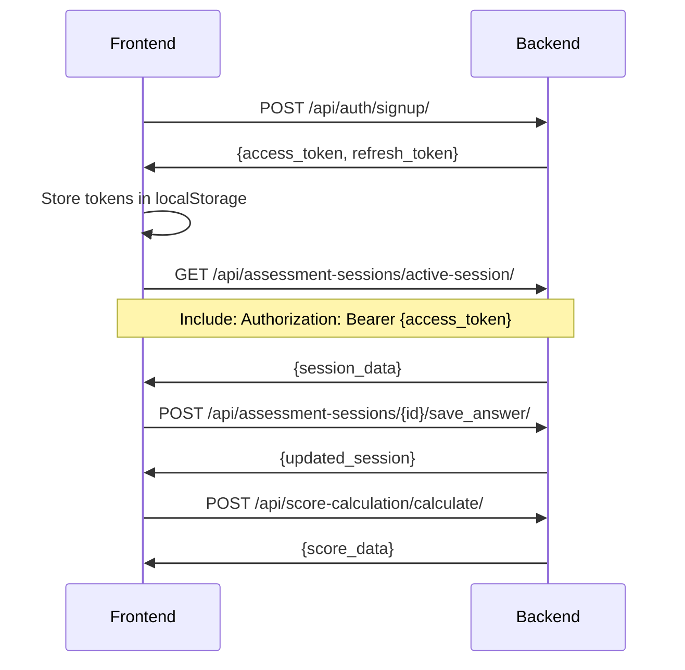

# ECHS Backend API Documentation

Welcome to the Eswatini Credit Health Score (ECHS) Backend API documentation for frontend developers.

## 📚 Documentation Overview

This directory contains comprehensive guides for integrating your frontend application with the ECHS backend API.

### Available Guides

1. **[API Integration Guide](./01_API_Integration_Guide.md)** - Complete technical reference
   - All available endpoints with detailed examples
   - Authentication flow (signup, signin, logout)
   - Assessment session management
   - Score calculation APIs
   - Real-time field validation
   - Error handling patterns
   - React component examples

2. **[Quick Reference](./02_Quick_Reference.md)** - Condensed cheat sheet
   - Endpoints at a glance
   - Request/response examples
   - Score bands and pillar weights
   - Rate limits and error codes
   - Complete user flow diagram

3. **[Frontend Setup Guide](./03_Frontend_Setup_Guide.md)** - Step-by-step configuration
   - Where to set the backend URL
   - Complete file structure for API integration
   - Axios client setup with auto token refresh
   - Service layer organization
   - Error handling utilities
   - Testing your connection

---

## 🚀 Quick Start

### 1. Configure Your Frontend

Create a `.env` file in your frontend project root:

```env
REACT_APP_API_BASE_URL=http://localhost:8000
REACT_APP_API_TIMEOUT=30000
```

### 2. Install Dependencies

```bash
npm install axios
# or
yarn add axios
```

### 3. Start the Backend

```bash
cd creditScore
python manage.py runserver
```

The backend will be available at `http://localhost:8000`

### 4. Test the Connection

```javascript
import axios from 'axios';

axios.get('http://localhost:8000/health/')
  .then(response => console.log('✅ Connected:', response.data))
  .catch(error => console.error('❌ Connection failed:', error));
```

---

## 🎯 Available Features

### Authentication
- ✅ User signup with phone number
- ✅ JWT token-based authentication
- ✅ Automatic token refresh
- ✅ Session management
- ✅ Rate limiting for security

### Assessment Session Management
- ✅ Create/resume assessment sessions
- ✅ 30-day session persistence
- ✅ Auto-save functionality
- ✅ Question navigation (forward/backward)
- ✅ Section progress tracking
- ✅ Skip optional questions

### Score Calculation
- ✅ 9 financial pillars with weighted scoring
- ✅ Composite score (300-850 range)
- ✅ Score bands (Poor/Weak/Fair/Good/Excellent)
- ✅ Pillar breakdown with individual contributions
- ✅ Validation flags for data outliers
- ✅ Historical score tracking

### Real-time Validation
- ✅ Single field validation (30 requests/min)
- ✅ Batch validation (10 requests/min)
- ✅ Field schema retrieval
- ✅ Context-aware cross-field validation
- ✅ Sub-500ms response time target

---

## 📊 9 Financial Pillars

The ECHS scoring system evaluates 9 key financial areas:

1. **Financial Obligations** (15% weight)
2. **Income & Employment** (15% weight)
3. **Mobile Money** (12% weight)
4. **Assets** (12% weight)
5. **Savings & Banking** (12% weight)
6. **Expense Management** (12% weight)
7. **Household Profile** (8% weight)
8. **Financial Literacy** (8% weight)
9. **Business Profile** (6% weight)

**Total Score Range:** 300-850

---

## 🔐 Authentication Flow



---

## 📝 Common API Endpoints

### Authentication
```
POST /api/auth/signup/               # Sign up
POST /api/auth/signin/               # Sign in
POST /api/auth/auth-logout/          # Logout
POST /api/auth/token/refresh/        # Refresh token
```

### Assessment
```
GET  /api/assessment-sessions/active-session/              # Get/create session
POST /api/assessment-sessions/{id}/save_answer/            # Save answer
POST /api/assessment-sessions/{id}/save_multiple_answers/  # Bulk save
POST /api/assessment-sessions/{id}/advance_question/       # Next question
POST /api/assessment-sessions/{id}/mark_completed/         # Submit
```

### Score
```
POST /api/score-calculation/calculate/  # Calculate score
GET  /api/score-calculation/latest/     # Get latest score
```

### Validation
```
POST /api/assessments/validate-field/   # Validate single field
POST /api/assessments/batch-validate/   # Validate multiple fields
GET  /api/assessments/field-schema/     # Get validation rules
```

---

## 🚨 Error Handling

All error responses follow this format:

```json
{
  "success": false,
  "error": "error_code",
  "message": "Human-readable error message",
  "details": {}
}
```

### Common HTTP Status Codes

| Code | Meaning | Action |
|------|---------|--------|
| 200 | Success | Process response |
| 201 | Created | Resource created |
| 400 | Bad Request | Check request format |
| 401 | Unauthorized | Token expired, refresh |
| 403 | Forbidden | No permission |
| 404 | Not Found | Resource doesn't exist |
| 429 | Rate Limited | Slow down requests |
| 500 | Server Error | Try again later |

---

## ⚡ Rate Limits

| Endpoint Type | Limit |
|--------------|-------|
| Signup | 5 per hour per IP |
| Signin | 10 per hour per IP |
| Field Validation | 30 per minute per user |
| Batch Validation | 10 per minute per user |
| Phone Verification | 5 per 10 minutes per IP |

---

## 🔒 Security Features

- ✅ JWT token authentication
- ✅ Automatic token refresh
- ✅ Rate limiting on all auth endpoints
- ✅ CORS configuration
- ✅ Encrypted sensitive data
- ✅ Session expiration (30 days)
- ✅ Audit logging
- ✅ HTTPS enforced in production

---

## 🌍 CORS Configuration

The backend accepts requests from:

- `http://localhost:3000` (React default)
- `http://127.0.0.1:3000`
- `http://localhost:8080`

To add more origins, update the backend `.env` file:

```env
CORS_ALLOWED_ORIGINS=http://localhost:3000,https://yourfrontend.com
```

---

## 📖 Example: Complete Assessment Flow

```javascript
// 1. User signs up
const signupData = await fetch('http://localhost:8000/api/auth/signup/', {
  method: 'POST',
  headers: { 'Content-Type': 'application/json' },
  body: JSON.stringify({
    phone_number: '+26878123456',
    password: 'SecurePass123!',
    password_confirm: 'SecurePass123!',
    email: 'john@example.com',
    full_name: 'John Doe',
    registration_channel: 'web'
  })
});
const authData = await signupData.json();
localStorage.setItem('access_token', authData.access_token);
localStorage.setItem('refresh_token', authData.refresh_token);

// 2. Get active session
const sessionData = await fetch('http://localhost:8000/api/assessment-sessions/active-session/', {
  headers: { 'Authorization': `Bearer ${tokens.access}` }
});
const session = await sessionData.json();

// 3. Save answer
await fetch(`http://localhost:8000/api/assessment-sessions/${session.session_id}/save_answer/`, {
  method: 'POST',
  headers: {
    'Authorization': `Bearer ${tokens.access}`,
    'Content-Type': 'application/json'
  },
  body: JSON.stringify({
    question_id: 'income_employment_monthly_income',
    answer_value: 15000
  })
});

// 4. Submit assessment
await fetch(`http://localhost:8000/api/assessment-sessions/${session.session_id}/mark_completed/`, {
  method: 'POST',
  headers: { 'Authorization': `Bearer ${tokens.access}` }
});

// 5. Calculate score
const scoreData = await fetch('http://localhost:8000/api/score-calculation/calculate/', {
  method: 'POST',
  headers: { 'Authorization': `Bearer ${tokens.access}` }
});
const score = await scoreData.json();
console.log('Score:', score.score.composite_score);
```

---

## 💡 Best Practices

1. **Always validate before saving** - Use validation endpoints
2. **Auto-save frequently** - Don't rely on manual save buttons
3. **Handle token refresh** - Implement automatic refresh
4. **Show progress** - Display `completion_percentage` to users
5. **Debounce validation** - Avoid hitting rate limits
6. **Cache landing page data** - It rarely changes
7. **Display warnings** - Show validation flags from score response
8. **Use HTTPS in production** - Never use HTTP for production

---

## 🧪 Testing

### Health Check
```bash
curl http://localhost:8000/health/
```

### Test Authentication
```bash
curl -X POST http://localhost:8000/api/auth/signin/ \
  -H "Content-Type: application/json" \
  -d '{"phone_number": "+26878123456", "password": "yourpassword"}'
```

### Test Active Session
```bash
curl http://localhost:8000/api/assessment-sessions/active-session/ \
  -H "Authorization: Bearer YOUR_ACCESS_TOKEN"
```

---

## 📞 Support

- **Backend URL (Dev):** `http://localhost:8000`
- **Admin Panel:** `http://localhost:8000/admin/`
- **Health Check:** `http://localhost:8000/health/`

For questions or issues:
1. Check the detailed guides in this directory
2. Review error messages carefully
3. Check backend logs: `tail -f echs.log`
4. Contact the backend team

---

## 🔗 Related Documentation

- [Main Project README](../../README.md)
- [Backend Setup Guide](../../README.md)
- [API Endpoints Module](../../api_endpoints/README.md)
- [Field Validation API](../../FIELD_VALIDATION_API.md)

---

## 📝 Version History

- **v1.0** (Current) - Initial API documentation
  - Complete authentication flow
  - Assessment session management
  - Score calculation with 9 pillars
  - Real-time validation
  - Landing page configuration

---

## 🤝 Contributing

When updating these docs:
1. Keep examples up-to-date with actual API
2. Test all code examples before committing
3. Update version history
4. Keep consistency across all three guides

---

**Happy Coding! 🚀**
